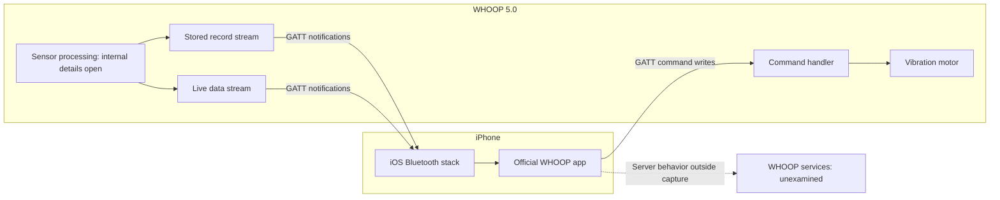
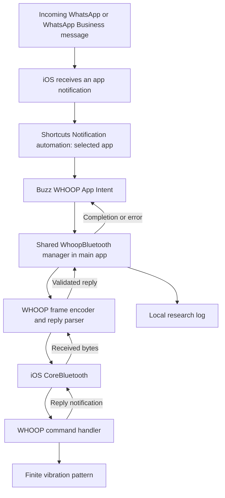
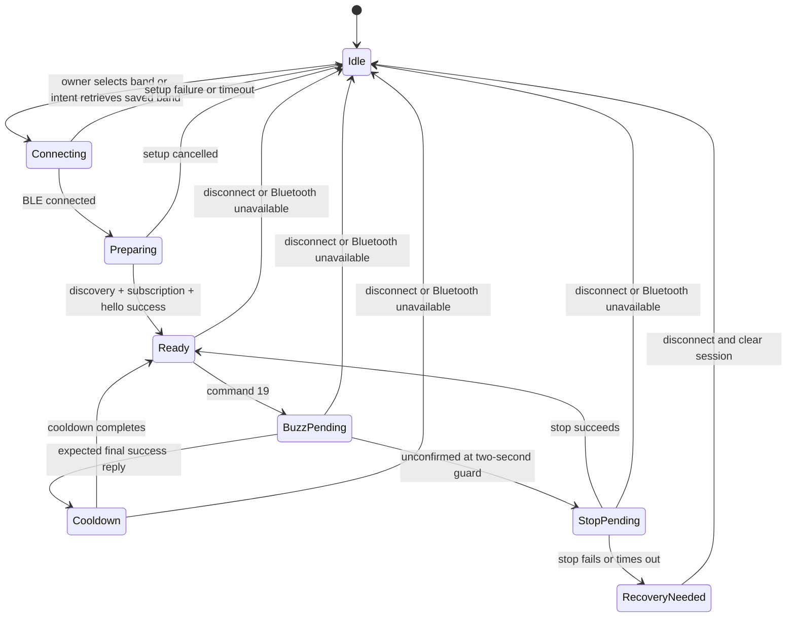

# WHOOP 5.0: connection research and iPhone notification bridge

Draft v1 — 9 October 2026. Based on the owner's captures, current app source, device logs, build results, and Apple documentation.

**Goal:** make the owner's WHOOP 5.0 vibrate when a selected iPhone app, including WhatsApp Business, posts a notification. The iPhone and band handle normal operation. The Mac handles research, building, signing, and reinstalling the prototype.

**Current result:** a direct command from the iPhone app has physically buzzed the band. The Shortcuts action has also buzzed it once on the earlier build. The updated stop-handling fix is installed. Repeated runs on that build, actual WhatsApp notification triggering, and operation with the phone locked still need physical tests.

## 1. Scope and evidence

The device is **WHOOP 5.0**. WHOOP One is the membership. The current setup is an iPhone 15 running iOS 27.0, a Mac with Xcode 27, and a free Apple Personal Team. The candidate firmware version decoded from the hello reply is `50.42.1.0`.

This document uses three labels:

- **Observed:** found in a capture, device log, build result, or owner's physical test.
- **Implemented:** present in the main `WhoopBuzz` source. This does not mean every operating condition has been tested.
- **Proposed:** an improvement or experiment still to be built or verified.

| Part | Evidence and present limit |
|---|---|
| WHOOP command/reply transport | Service discovery, valid checksums, and matched command replies in captures |
| Manual vibration | Owner confirmed one physical buzz |
| Shortcuts action | Free-team signed, installed, invoked; earlier build produced one physical buzz |
| Notification automation | Owner sees the iOS 27 Notification trigger and created an automation |
| WhatsApp Business delivery | Intended source; no completed end-to-end physical test yet |
| Updated stop handling | Built, checked, installed, and launched; physical retest pending |
| Locked-phone operation | Declared background support; physical delivery remains unverified |
| Live heart rate | Candidate field found; repeated time-aligned validation is still needed |
| WHOOP health scores and cloud processing | Not established by these Bluetooth captures |

Authoritative current status: [prototype-status.json](WhoopBuzz/prototype-status.json). Older reference manifests contain descriptions written before the successful physical buzz; use the current status for validation claims.

## 2. What we know about WHOOP's normal connection

The captures reveal the connection between the official iPhone app and the band. They do not reveal WHOOP's full internal hardware, firmware, or server architecture.



The band sends live and stored data through vendor Bluetooth characteristics. A **characteristic** is a named endpoint inside a Bluetooth service. The phone writes commands to one endpoint and receives vendor replies on another.

One official-app reconnect showed this sequence:

| Time after connection | Observation |
|---:|---|
| 0.000 s | Bluetooth connection established |
| 0.273 s | Link encryption enabled |
| 0.365 s | ATT MTU negotiated to 247 bytes |
| 0.875 s | Vendor characteristics discovered |
| 1.502 s | Hello command written |
| 2.015 s | Stored-record range requested |
| 3.366 s | Historical transfer requested |
| 3.558 s | First stored record in the new transfer |
| 5.060 s | Last stored record in that transfer |

These are measurements from one capture, not timing guarantees. This was a reconnect to an already paired band; first-time pairing was not captured. The notification app does not reproduce WHOOP's configuration or historical-sync sequence. It needs only a working command session.

Evidence: [reconnect findings](reconnect-findings.md), [comparison data](reconnect-comparison.json).

## 3. Selected notification architecture

The selected route uses the iPhone's **Shortcuts Notification automation** to detect an app notification. It invokes **Buzz WHOOP**, an App Intent supplied by our app. An App Intent is an action that iOS can run through Shortcuts.

Apple's iOS 27 guide documents an app selector and optional notification text filters. The owner confirmed the trigger is available on this phone. [Apple: event triggers](https://support.apple.com/guide/shortcuts/event-triggers-apd932ff833f/ios).



The runtime boundary starts when iOS delivers the notification event. Internet connectivity may be needed for WhatsApp to receive its message. Our buzz path has no server, webhook, WHOOP cloud request, or Mac connection.

The app receives a request to buzz. The current intent has no parameter for the sender, message text, source app, or notification identifier. Selection and filtering happen in Shortcuts. WhatsApp and WhatsApp Business are separate source apps and need the intended app selected in the automation.

The official WHOOP app was used to study the protocol. Our prototype talks directly to the band through CoreBluetooth; it does not call the official app to request vibration. Coexistence with the official app still needs testing over longer sessions.

## 4. Modules and responsibilities

| Module | Responsibility | Current file |
|---|---|---|
| Shortcuts automation | Select source app and call Buzz WHOOP | Configured on the owner's iPhone |
| App Intent | Await one buzz, return completion or an error | [BuzzWhoopIntent.swift](WhoopBuzz/Sources/BuzzWhoopIntent.swift) |
| Connection and command manager | Discover, connect, subscribe, establish session, serialize writes, match replies | [WhoopBluetooth.swift](WhoopBuzz/Sources/WhoopBluetooth.swift) |
| Protocol codec | Encode frames, check length/checksums, buffer incoming fragments | [WhoopFrame.swift](WhoopBuzz/Sources/WhoopFrame.swift) |
| Foreground UI | Choose band, connect, test, stop, read log | [WhoopBuzzApp.swift](WhoopBuzz/Sources/WhoopBuzzApp.swift) |
| Local preferences | Save band UUID and recent log entries | App-local UserDefaults |
| Offline decoder | Read captures and produce structured research evidence | [decode_capture.py](decode_capture.py) |

The UI and intent use `WhoopBluetooth.shared`. It is a `@MainActor` object; CoreBluetooth callbacks use the main queue. This keeps the prototype's connection state and command state in one execution context.

The shared instance exists **within one app process**. It does not survive process termination. The saved peripheral identifier survives normal launches; live pending commands do not.

### App Intent contract

Implemented configuration:

```swift
supportedModes = .background
authenticationPolicy = .alwaysAllowed
allowedExecutionTargets = .main
```

The intent runs in the main app target and is declared to support background execution. The authentication setting permits the action without an app-level unlock requirement. These settings do not prove successful execution while locked or give unlimited background time. [Apple: supported modes](https://developer.apple.com/documentation/appintents/appintent/supportedmodes), [execution targets](https://developer.apple.com/documentation/appintents/appintent/allowedexecutiontargets).

`perform()` awaits `buzzFromShortcut()`. It returns success only after the controller observes the expected one-shot reply and finishes its cooldown. It does not return immediately after sending bytes.

## 5. Connection lifecycle

### First connection: foreground setup

1. Check that Bluetooth is powered on and permission is allowed.
2. Retrieve already connected peripherals advertising the WHOOP service.
3. Scan in the foreground for up to 15 seconds. The current scan accepts a WHOOP name or the known service UUID.
4. Let the owner select their band.
5. Connect and discover the vendor service and command/reply characteristics.
6. Enable reply notifications; await successful subscription.
7. Send hello command `145`, revision `3`, sequence `1`.
8. Await its vendor success reply.
9. Set `isReady` and save the peripheral UUID.

A connected Bluetooth link is only the start. **Ready** means the required characteristics, reply subscription, and successful hello are in place.

### Later Shortcuts invocation

1. Reject an overlapping vibration test or Shortcut operation.
2. Wait briefly if the Bluetooth manager is still initializing or resetting.
3. Require Bluetooth to be powered on.
4. If ready, use the existing session.
5. Otherwise retrieve the saved peripheral UUID and connect without a background scan.
6. Await readiness, send one buzz, and await its outcome.

The action has a configured 20-second overall deadline. A missing saved peripheral produces an instruction to connect once in the app. An out-of-range band or failed setup produces an error rather than silently reporting success.

**Current gap:** after a failed stop, the link can remain connected while `isReady` is false. The present intent waits for readiness but does not automatically rebuild that connected session. Manual disconnect/reconnect is the recovery path. Automatic session recovery is proposed below.

### Conceptual states

The following diagram describes the controller's intended flow. The current implementation uses Boolean flags rather than this explicit state enum.



## 6. BLE transport and endpoints

All UUIDs below share suffix `-cce1-4033-93ce-002d5875f58a`.

| UUID prefix | Recorded value handle | Role | Used by buzz app? |
|---|---|---|---|
| `fd4b0001` | — | Custom service | Yes |
| `fd4b0002` | `0x099b` | Command writes | Yes |
| `fd4b0003` | `0x099d` | Command reply notifications | Yes |
| `fd4b0004` | `0x09a0` | Event-capable channel; baseline event observed | No |
| `fd4b0005` | `0x09a3` | Live/stored data, metadata, logs, events | No |
| `fd4b0007` | `0x09a6` | Notify-capable; purpose open | No |

Handles belong to the recorded attribute database. The app discovers endpoints by UUID, so it does not depend on those handles staying the same.

Commands use `.withResponse` writes. Before sending, the app checks the characteristic supports that mode and the frame fits `maximumWriteValueLength(for: .withResponse)`. The hello and stop frames are 16 bytes; the buzz frame is 28 bytes. There is no outgoing frame chunking in the current app.

The observed MTU of 247 belongs to the official-app capture. Our app relies on iOS to manage the link and checks the actual allowed write size; it does not force that MTU.

### Two different acknowledgements

1. **ATT write response:** confirms completion of the Bluetooth attribute write.
2. **WHOOP vendor reply:** reports the command result and operation-specific detail.

Neither alone measures motor movement. Physical observation is a separate layer of evidence.

## 7. WHOOP format-1 frames

Offsets start at zero in the WHOOP frame, after Bluetooth wrappers are removed. This is the format implemented and checked against the owner's captures.

| Offset | Width | Meaning |
|---:|---:|---|
| 0 | 1 | Start byte `AA` |
| 1 | 1 | Format `01` |
| 2 | 2 | Declared length, little-endian: inner payload length + 4 |
| 4 | 2 | Outgoing header bytes `00 01` |
| 6 | 2 | Header CRC16, little-endian |
| 8 | Variable | Inner payload |
| Last 4 | 4 | Inner-payload CRC32, little-endian |

Total frame size is `declaredLength + 8`. Header CRC16 uses Modbus parameters: initial `FFFF`, reflected polynomial `A001`, applied to bytes 0–5. Payload CRC32 is compatible with Python `zlib.crc32`, applied only to the inner payload, including padding.

Outgoing inner payload:

```text
23 | requestSequence:u8 | command:u8 | body | zero padding
```

`23` is hexadecimal, or decimal 35. The whole outgoing inner payload is padded to a multiple of four bytes before CRC32 is computed.

Incoming command-reply inner payload:

```text
24 or 26 | replySequence:u8 | command:u8 | originSequence:u8 | result:u8 | body
```

The first bytes are hexadecimal `24`/`26`, decimal 36/38. The app matches **command + echoed origin sequence** to its pending table; it does not treat the reply's own sequence as the request identifier.

| Result | Current interpretation |
|---:|---|
| 0 | Failure |
| 1 | Success; also inspect the command's reply body |
| 2 | Pending; keep waiting for a final reply |
| 3 | Unsupported |

### Commands the app sends

| Command | Body, hexadecimal | Purpose |
|---:|---|---|
| 145 (`91`) | `03` | Establish the command session using the captured hello revision |
| 19 (`13`) | `01 2F 98 00 00 00 00 00 00 00 00 00` | Request the observed finite notification pattern |
| 122 (`7A`) | `01` | Request haptic stop |

Command 19 body layout, using the pinned community reference:

| Body offset | Width | Value |
|---:|---:|---|
| 0 | 1 | Revision 1 |
| 1 | 8 | Effects `[47, 152, 0, 0, 0, 0, 0, 0]` |
| 9 | 2 | Effect-loop control, little-endian 0 |
| 11 | 1 | Overall repeats 0 |

This body has produced a brief physical buzz on the owner's band. Exact duration, strength, effect vocabulary, and behavior on other firmware remain unmeasured. The band's finite pattern supplies the normal ending; a phone timer is not the normal motor-stop mechanism. [Pinned NOOP haptics reference](https://github.com/ryanbr/noop/blob/8e94d559be273ec8d74832fe5db78898be83cc11/docs/PROTOCOL_ALARMS.md).

Checksum-checked frame examples:

```text
Hello, request sequence 1:
aa0108000001e671230191031a5f5263

Buzz, request sequence 2:
aa0114000001e1e1230213012f9800000000000000000000e1a1feb4

Stop, request sequence 3, only if needed:
aa0108000001e67123037a017fc05233
```

These sequences are examples. Runtime sequences increment and wrap, with sequence 1 reserved for hello. A confirmed normal buzz does not automatically send the illustrated stop.

## 8. Command and vibration lifecycle

### Normal successful path

```mermaid
sequenceDiagram
    participant S as Shortcuts
    participant I as App Intent
    participant C as Bluetooth controller
    participant B as WHOOP
    S->>I: Buzz WHOOP
    I->>C: buzzFromShortcut()
    opt Session not ready
        C->>B: Connect, discover, subscribe
        C->>B: Hello 145, sequence 1
        B-->>C: Correlated hello success
    end
    C->>B: Write command 19, sequence N
    B-->>C: ATT write response
    B-->>C: Vendor pending, result 2
    Note over B: Finite pattern; physical timing separately observed
    B-->>C: Final result 1, revision 1, detail 5
    C->>C: Release busy at cooldown guard
    C-->>I: Expected reply confirmed
    I-->>S: Action completed
```

The diagram shows the logical flow; exact reply/motor timing can differ. Some operations may not emit a visible pending reply.

`WhoopHapticReply.oneShotSucceeded` requires all three values:

```text
result == 1 AND revision == 1 AND detail == 5
```

A pending result, generic success with the wrong detail, truncated body, or wrong revision does not pass this check. Stop has a different reply shape: it is not validated using the buzz detail byte.

### Queues and timers currently implemented

| Mechanism | Current behavior |
|---|---|
| Write queue | One ATT write in flight; advance after `didWriteValueFor` |
| Pending command table | Requests can remain pending after the ATT write finishes |
| Vendor correlation | Match request sequence and command; retain result 2 as pending |
| Scan guard | 15 seconds |
| Setup guard | 15 seconds from connection request |
| Command reply limit | 10 seconds from enqueue |
| Buzz guard/cooldown | 2 seconds from starting the buzz operation |
| Shortcut overall limit | 20 seconds; state checked at roughly 100 ms intervals |
| Stale timer guards | Session, scan, and buzz generation tokens |

These are app-configured deadlines while execution is scheduled. They are not iOS execution allowances or real-time guarantees. There is no durable queue of notification events. Requests arriving during an active operation are rejected with an already-running error.

### What changed after the first failed Shortcut test

The earlier run had a successful command-19 reply, and the owner felt a brief buzz. Two seconds later the old app sent a stop. That stop returned failure 0, and the app left itself busy while reporting the whole action as failed.

The installed fix now:

- Completes a confirmed finite buzz after the cooldown without sending an extra stop.
- Keeps a stop fallback when the expected buzz reply is absent at the two-second guard.
- Clears busy on terminal stop failure and invalidates the old buzz guard.
- Disables readiness after an uncertain stop, requiring session recovery.
- Avoids automatically repeating a rejected stop from the Shortcut error handler.
- Logs the actual Bluetooth manager state when it changes.

The reason the old stop was rejected is not proven. The pattern already ending is a plausible explanation. The confirmed bug was the app's handling of that failed stop.

## 9. Failure handling and remaining gaps

| Failure | Implemented response | Remaining work |
|---|---|---|
| Bluetooth off or access denied | Clear session; report the specific state | Verify state transitions during a locked run |
| No saved peripheral | Ask owner to connect once in the app | Test after deleting/reinstalling app |
| Band out of range | Connection/setup or action timeout | Measure recovery when it returns |
| Missing service or reply subscription | Log setup problem; readiness stays false | Unified terminal setup outcome |
| ATT write failure | Clear busy, disable readiness, clear queued writes | Prove all pending requests settle once |
| Corrupt or unmatched reply | Reject or ignore it | Record parser rejection counts |
| Stop failure or timeout | Clear busy; require reconnect | Automatically rebuild connected-but-not-ready session |
| Disconnect during operation | Clear session and fail action | Test reconnect and stale callbacks |
| Overlapping notifications | Reject overlapping action | Decide coalescing behavior and measure bursts |
| Process suspension or termination | Saved band/log survive; pending operations do not | Test lifecycle; consider Bluetooth restoration |

Two implementation edges deserve attention before claiming reliability:

1. The two-second guard can act while a stop or buzz reply is still pending. A late final buzz reply may arrive after a stop request has started. A manual stop can also overlap the cooldown guard. These outcomes should be resolved by one explicit operation state rather than separate flags and timers.
2. A Shortcut timeout/cancellation does not currently provide a fully atomic cleanup of every pending write, timer, and late reply. The action may report failure even if the band acted. Automatically retrying that uncertain buzz could create duplicates.

An unconfirmed buzz is an **unknown physical outcome**, not proof of no vibration. A timeout is not proof that the motor stopped.

### Proposed hardening

Keep the same four-file app and add focused changes:

1. Model connection state and haptic operation state explicitly. Give each operation one request ID, deadline, and terminal outcome.
2. Resolve reply, stop, disconnect, cancellation, and timeout through that same operation. Settle its awaiting intent exactly once.
3. On a connected-but-not-ready session, cancel and re-establish it before accepting a new buzz.
4. Keep the finite pattern. Do not rely on a suspended process running a stop timer.
5. Avoid blind retry after an uncertain write. Recover the session and make the uncertainty visible in the log.
6. If burst handling is needed, merge requests during an active buzz into that alert; do not replay a long backlog when the band returns. The current intent has no notification IDs, so exact deduplication is unavailable.
7. Consider CoreBluetooth state restoration only after locked/cold-start testing shows it is needed. It restores Bluetooth state, not Shortcuts event history or a haptic success result.

These are proposals, not features already installed.

## 10. Background execution and notification behavior

`Info.plist` declares `UIBackgroundModes = ["bluetooth-central"]`. Apple documents Bluetooth event handling in the background and opt-in state restoration. This mode does not keep arbitrary timers running continuously. The current app has no restoration identifier or `willRestoreState` implementation. [Apple: CoreBluetooth background processing](https://developer.apple.com/library/archive/documentation/NetworkingInternetWeb/Conceptual/CoreBluetooth_concepts/CoreBluetoothBackgroundProcessingForIOSApps/PerformingTasksWhileYourAppIsInTheBackground.html).

The design avoids background discovery during a normal Shortcut by retrieving the saved peripheral. That still requires an app process, an available radio, a reachable band, and a completed session setup.

Treat these notification conditions as experiments:

| Condition | Question to answer |
|---|---|
| WhatsApp Business notification | Does the selected automation invoke the intent and produce one physical buzz? |
| Phone locked | Does the full action complete without opening the app? |
| Hidden previews | Does the trigger still run with the owner's normal preview setting? |
| Focus or muted chat | Does the trigger run for an alert the phone silences? Is that desired? |
| Several messages together | How many invocations and physical buzzes occur? |
| Incoming WhatsApp call | Does it produce the same kind of trigger event as a normal notification? |
| App not recently opened | Can the intent start the main app and restore a working session? |
| Force-quit, reboot, or profile expiry | Which parts stop working, and what restores them? |

Start with app selection and no text filters. Test filters separately. There is no app-side notification listener, Focus policy, or notification content parser in the current implementation.

### Why the other routes are outside this version

| Route | Finding |
|---|---|
| Ordinary notification APIs | They do not give our app a general feed of WhatsApp notifications |
| ANCS | Needs accessory-side support. No notification-sharing switch was visible for this WHOOP, and no working ANCS route was observed |
| Apple Accessory Notifications | A real newer API, but the tested transport-extension capability could not sign with the free team |
| Mac notification bridge | Requires the Mac during operation; outside the owner's phone-only requirement |
| WhatsApp Business Cloud API | Separate account/API/server setup; not a notification feed automatically supplied by the Business phone app |

Apple's documented Accessory Notifications route includes accessory registration and data-provider, security, and transport extensions for encrypted forwarding. Only the transport entitlement was signing-probed here. A provider-triggered local buzz is a separate, untested idea; neither that idea nor WHOOP compatibility with the documented encrypted forwarding path has been established. [Apple: receiving notifications on an accessory](https://developer.apple.com/documentation/accessorytransportextension/receiving-ios-notifications-on-an-accessory).

No ANCS UUID in a few captures and no Settings switch do not prove permanent firmware impossibility. They mean there is no demonstrated route to use now. [Apple: ANCS specification](https://developer.apple.com/library/archive/documentation/CoreBluetooth/Reference/AppleNotificationCenterServiceSpecification/Introduction/Introduction.html).

## 11. Research and observability architecture

The research pipeline is separate from the installed app:

```text
Official WHOOP app activity on iPhone
    → Apple Bluetooth logging profile / host trace
    → PacketLogger on Mac over USB
    → immutable saved .pklg capture
    → decode_capture.py
    → decoded summary + frames.jsonl
    → timeline, command/reply comparison, candidate sensor plots
```

PacketLogger observes host/controller traffic, not a raw over-the-air radio capture. The decoder reads PacketLogger records, HCI ACL data, L2CAP, ATT writes/notifications, and then WHOOP frames. Link encryption and readable host-side payloads can coexist because these are different observation points.

The decoder validates length, header CRC16, and inner CRC32, and retains raw frames with capture offsets and times. It currently handles complete ATT messages containing complete WHOOP frames. Unsupported ACL/frame fragments are counted; full ACL reassembly is not implemented. The app's reply parser separately handles notification payloads split across callbacks.

| Capture | Complete validated WHOOP frames | Main use |
|---|---:|---|
| [Baseline](whoop-baseline-01.decoded.json) | 567 | Initial channel and message mapping |
| [Reconnect](whoop-reconnect-01.decoded.json) | 968 | Discovery, encryption, setup, history continuation |
| [Live HR](whoop-live-hr-01.decoded.json) | 305 | Candidate live data field and update rate |

The reconnect capture contains 441 consecutive stored-record counters from 101565 through 102005. This supports continuity for that record stream in that capture; it does not establish completeness of all sensor data.

The live capture contains 91 type-40 frames across about 90 seconds. Candidate HR is at full-frame byte 16 in the observed 32-byte shape, ranging 52–64. The owner's untimed reading of 61 is consistent with that field but does not validate it. Device clock alignment and other time-field units remain open. [Live HR findings](live-hr-findings.md), [pinned sensor reference](https://github.com/ryanbr/noop/blob/8e94d559be273ec8d74832fe5db78898be83cc11/docs/PROTOCOL_SENSORS.md).

### Runtime log

Current app preferences retain:

- `whoop.savedPeripheral`: CoreBluetooth peripheral UUID, saved after successful hello.
- `whoop.researchLog`: the newest 40 local text entries, with time but no date.

Logs include process startup, Bluetooth state, connection/setup, Shortcut entry, reply results, and failure messages. A Shortcut-entry line proves the action ran. It does not identify which notification triggered it. Compare the logged time with a controlled message arrival and physical observation.

Proposed log improvements: full UTC date/time, build identifier, operation ID, request sequence, command, Bluetooth state, elapsed time, final outcome, and parser rejection count. Keep message text and sender details out of the log because they are not needed for vibration research.

## 12. Security, storage, and deployment

The buzz app stores only its band identifier and diagnostic log. It does not collect notification message content, use WhatsApp credentials, upload data, or read the official WHOOP app's private storage.

The initial WHOOP name/service filter is discovery assistance, not cryptographic identity verification. The owner selects the band, and UUID discovery plus hello establish protocol readiness. Link encryption was observed during the official reconnect; the hello exchange and CRCs do not establish a separate WHOOP app authentication mechanism. CRCs detect corruption, not a forged command.

The app only emits commands 145, 19, and 122. Research captures also contain history, live-stream, and configuration commands from the official app; the buzz app does not send those.

The main app's deployment target is iOS 18, but its current Buzz WHOOP intent requires iOS 27. Build and install use Xcode 27 and bundle identifier `dev.yajat.WhoopBuzzResearch`.

The installed development profile expires **15 October 2026 at 23:23:59 UTC**. The free-team prototype therefore needs periodic signing and reinstalling from the Mac. “iPhone only” describes normal runtime, not indefinite installation maintenance. Use the profile's actual expiry when planning tests.

### Main build versus Claude's experiment

The installed main implementation is [WhoopBuzz](WhoopBuzz/WhoopBuzz.xcodeproj/project.pbxproj), with deployment evidence in `stop-fix-build.log`, `stop-fix-install-result.json`, and `stop-fix-launch-result.json`.

Claude's separate [WhoopBridge experiment](Claude-Experiments/README.md) reports a signed build with different completion, cooldown, burst, and reconnect handling. Its README says it was not installed. It uses the same bundle identifier, so installing either version replaces the other. Do not combine their behavior claims when interpreting a phone log. Label tests by build/source version before switching.

## 13. Validation plan and completion gate

Already checked: captured hello parity, fragmented reply parsing, corrupted frame rejection, header resynchronization, exact command bytes/checksums, and one-shot result/revision/detail checks. The main fixed build signed, installed, and launched. These checks establish software/protocol behavior; they do not establish notification delivery under every phone condition.

Run physical tests in this order:

| Step | Test | Evidence required |
|---:|---|---|
| 1 | Reconnect in the installed app; run Buzz WHOOP twice several seconds apart | Two physical buzzes, two expected final replies, no stuck busy state or extra stop on normal success |
| 2 | Send a controlled WhatsApp Business message with phone unlocked and apps in background | Notification arrival time, Shortcut-entry line, final reply, one physical buzz |
| 3 | Repeat with phone locked, using normal preview settings | Same chain, no unlock/open-app step |
| 4 | Repeat with ordinary WhatsApp selected | Confirm source app selection works independently |
| 5 | Bluetooth off, band out of range, then reconnect | Clear failure, no false success, recovery restores next test |
| 6 | Send three messages close together | Record invocations, errors, and buzz count; assess overlap policy |
| 7 | Test Focus, muted chat, and hidden previews | Record actual behavior and decide desired alert policy |
| 8 | Cold app launch, reboot, and longer background idle | Establish practical lifecycle limits |

Suggested first acceptance gate: **10 controlled WhatsApp Business notifications with the phone locked, spaced beyond the cooldown, each producing one physical buzz and a matching successful action log, followed by successful recovery from an out-of-range test.** This is a proposed test target, not a claim of present reliability.

For connection-controller changes, add focused tests around delayed final replies, stop/cooldown races, Bluetooth loss, cancellation, and connected-but-not-ready recovery. Preserve the existing capture-based codec checks.

The next research experiments are separate: time-aligned HR readings to validate the candidate field; controlled internet-off testing to identify which official-app features are local; and a longer disconnect/history catch-up capture. These should retain original captures, hashes, raw bytes, and explicit uncertainty.

## 14. Reference map

- [Main project status](WhoopBuzz/prototype-status.json): latest installed-build and owner-test status.
- [Claude handover](CLAUDE-HANDOVER.md): project context and troubleshooting evidence.
- [Research plan](research-plan.md): experiments and capture procedure.
- [Source manifest](references/sources.json): pinned community source revisions and hashes.
- [Goose protocol source](https://github.com/b-nnett/goose/blob/ba9ae0280c9b5b9a1545baab8e944cb3b7563c62/Rust/core/src/protocol.rs): frame interpretation reference.
- [NOOP alarms/haptics](https://github.com/ryanbr/noop/blob/8e94d559be273ec8d74832fe5db78898be83cc11/docs/PROTOCOL_ALARMS.md): WHOOP 5 command bodies and operation-specific reply semantics.
- [Saved Apple trigger evidence](references/apple-shortcuts-event-triggers-source.json): retrieval date and HTML hash; availability was subsequently confirmed by the owner.

This architecture is a reproducible personal prototype and research map. Its next milestone is a measured, repeatable notification-to-buzz path on the locked iPhone.
